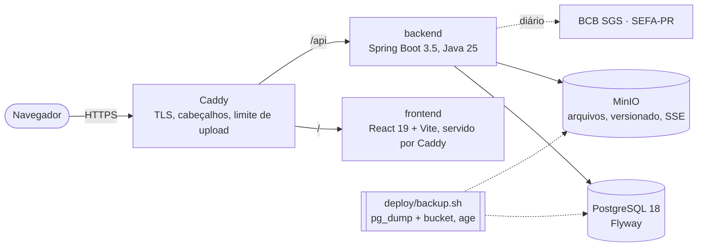

# FiscalHub

Ferramenta para consultores tributários em escritórios com vários clientes: importa as escriturações e os documentos
fiscais, concilia apurado × declarado × pago, aponta riscos e oportunidades, simula parcelamentos e transações e emite
relatórios. Os dados são fiscais e sigilosos (CTN, art. 198, e LGPD).

**Princípios:** nenhum valor fiscal é digitado (tudo vem de arquivo, e cada número abre a origem: arquivo, registro e
linha); normas são dado com fonte e vigência; estimativa e projeção são rotuladas; na dúvida, o mais seguro.

## Arquitetura

Um servidor com Docker Compose; só o proxy publica portas (80/443). O backend lê os arquivos em stream, grava o que
leu com a origem e calcula tudo no servidor; o frontend só mostra. Pacotes do backend por domínio (`importacao`, `sped`,
`fiscal`, `situacao`, `capacidade`, `parcelamento`, `pontos`, `relatorio`, `lgpd`, `security`).

## Como rodar

| Para | Como |
|---|---|
| Desenvolver (backend e frontend na máquina) | `.\iniciar.ps1` — confere Java 25, Maven, Node e o PostgreSQL local, gera o `backend/.env` e sobe os dois |
| Tudo em contêineres (só Docker) | `.\iniciar.ps1 -Docker` — `compose.yaml` + `compose.dev.yaml` em http://localhost |
| Produção | [docs/operacao/runbook.md](docs/operacao/runbook.md) — `.env` a partir do `.env.example`, `docker compose up -d --build` |
| Testes | backend `mvn verify` (Docker para o Testcontainers); frontend `npm test`, `npx playwright test`; restauração `deploy/teste-restauracao.sh` |

## Documentação

| Assunto | Onde |
|---|---|
| Backend: modelo, importação, leiautes, conciliação, relatórios, capacidade, simulações, pontos, segurança | [backend/README.md](backend/README.md) |
| Frontend: estrutura, design system, telas, testes | [frontend/README.md](frontend/README.md) |
| Guia do consultor (com capturas) | [docs/guia/](docs/guia/README.md) |
| Operação: subir, atualizar, backup, restaurar, segredos, incidentes | [docs/operacao/runbook.md](docs/operacao/runbook.md) |
| Segurança: OWASP ASVS nível 2 | [docs/seguranca/asvs.md](docs/seguranca/asvs.md) |
| LGPD: inventário, termos, acordo de tratamento | [docs/lgpd/](docs/lgpd/README.md) |
| Normas: fontes conferidas e rotina de atualização | [docs/normativas/](docs/normativas/atualizacao.md) |
| Mudanças por versão | [CHANGELOG.md](CHANGELOG.md) |

## Como contribuir

1. Branch a partir de `v2` (ou `main` depois do merge), commits pequenos no padrão `tipo(escopo): descrição`
   (`feat`, `fix`, `refactor`, `docs`, `test`, `ci`, `chore`), em português.
2. Mudança de schema = migração Flyway nova; mudança de norma = dado com fonte e vigência (`docs/normativas/atualizacao.md`).
3. Teste junto: unidade ou integração no backend, Vitest ou e2e no frontend; a massa fictícia é o aceite.
4. CI verde e revisão no PR (a `main` é protegida: abaixo).
5. Documento real nunca entra no repositório: anonimize (`anonimizar.ps1`) e use `amostras-locais/` (fora do git).

## Integração contínua

| Workflow | Quando | O que faz |
|---|---|---|
| [`ci.yml`](.github/workflows/ci.yml) | PR e push em `main`/`v2` | `backend` (`mvn verify` com Testcontainers), `frontend` (lint, `tsc -b`, Vitest, build), `e2e` (Playwright contra o `compose.dev.yaml`, com relatório, capturas e logs como artefato na falha), `segredos` (gitleaks no histórico inteiro) e `npm-audit` (só alta e crítica) |
| [`codeql.yml`](.github/workflows/codeql.yml) | PR, push e semanal | CodeQL `security-extended` em Java e TypeScript |
| [`dependencias.yml`](.github/workflows/dependencias.yml) | push em `main`/`v2`, semanal e manual | OWASP Dependency-Check do backend; quebra só com CVSS ≥ 7 |
| [`dependabot.yml`](.github/dependabot.yml) | semanal | Maven, npm, Actions, Dockerfiles e compose, agrupados por ecossistema |

Achados do gitleaks aceitos ficam em [`.gitleaksignore`](.gitleaksignore), um por linha e com a justificativa (o
`JWT_SECRET` antigo do commit inicial da v2 já foi trocado e não vale em nenhum ambiente).

### Ação manual no GitHub

1. **Proteção da branch `main`** (Settings → Branches → Add branch ruleset, alvo `main`):
   - exigir pull request antes do merge, com **1 aprovação**, descartando aprovações quando houver commit novo e exigindo
     a resolução das conversas;
   - exigir os status checks, com a branch atualizada: `backend`, `frontend`, `e2e`, `segredos`, `npm-audit` (do CI) e
     `analisar (java-kotlin, manual)` e `analisar (javascript-typescript, none)` (do CodeQL);
   - bloquear force push e exclusão da branch; incluir administradores.
2. **Secret `NVD_API_KEY`** (Settings → Secrets and variables → Actions): chave gratuita do NVD para o OWASP
   Dependency-Check. Sem ela o workflow `Dependências` leva horas baixando a base.
3. **Code scanning** (Settings → Code security): habilitar o Dependabot alerts e security updates; o CodeQL publica
   sozinho em Security → Code scanning.
