# Guia do consultor

Do cadastro do escritório à proposta de regularização, com a massa fictícia da Metalúrgica Pinheiral. As capturas são
geradas pelo Playwright (`frontend/e2e/guia.spec.ts`), nos dois temas: depois de mudar uma tela, suba o ambiente
(`.\iniciar.ps1 -Docker`) e rode `E2E_URL=http://localhost npm run guia` na pasta `frontend`; as imagens desta pasta se
atualizam.

> Os números das telas vêm só dos arquivos importados. Nada é digitado, e cada valor abre a origem: arquivo, registro
> ou página e linha.

## 1. Cadastro e primeiro acesso

O primeiro usuário cadastra o escritório e vira **ADMIN**. No primeiro acesso, cada usuário lê e aceita os Termos de Uso
e a Política de Privacidade. Em **Segurança** (menu do usuário), ative a verificação em duas etapas; o ADMIN pode
exigi-la de todo o escritório.

| Claro | Escuro |
|---|---|
| 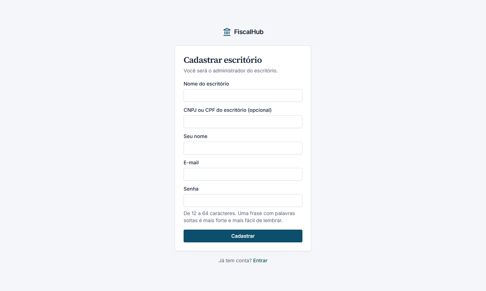 | 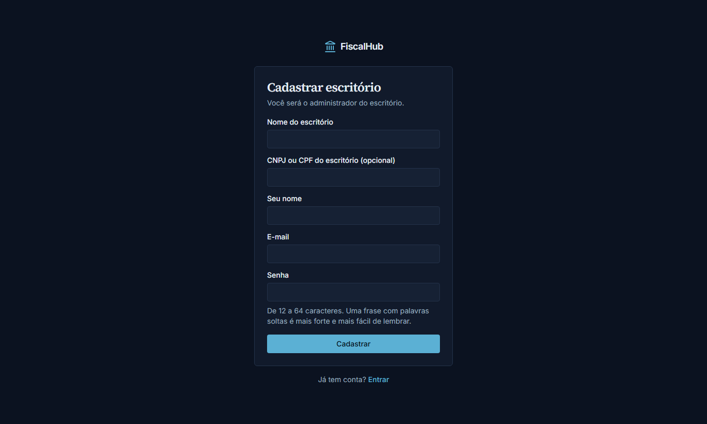 |

## 2. Painel e clientes

O Painel mostra a carteira: pontos críticos e altos por cliente, importações pendentes e com erro, simulações
recentes. Em **Clientes**, cadastre a empresa pelo CNPJ (ou deixe a central de importação sugerir pelo arquivo).

| Claro | Escuro |
|---|---|
| 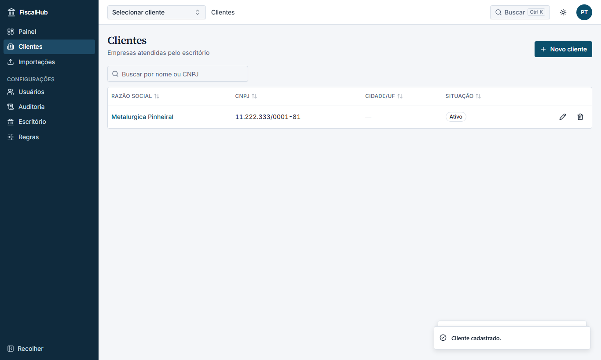 | 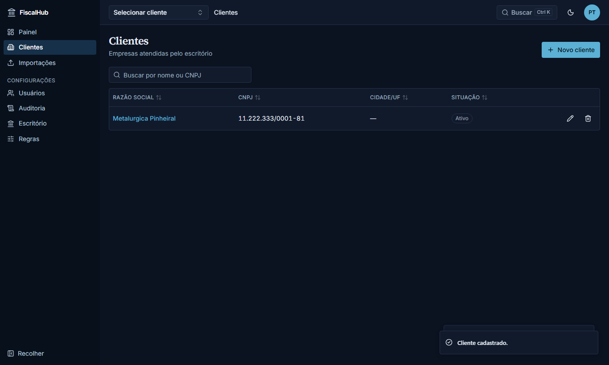 |

## 3. Importar

Na aba **Importações** do cliente (ou na central do escritório), arraste os arquivos: ECD, ECF, EFD-Contribuições,
EFD ICMS/IPI, balancete, DCTF/DCTFWeb, Relatório de Situação Fiscal, Regularize, CAPAG, DARF, pagamentos e os
documentos do PR. O tipo vem do conteúdo; cada arquivo mostra as etapas e as inconsistências.
Layout não reconhecido: o arquivo fica guardado; gere uma versão anonimizada com `anonimizar.ps1` e envie ao suporte.

| Claro | Escuro |
|---|---|
| 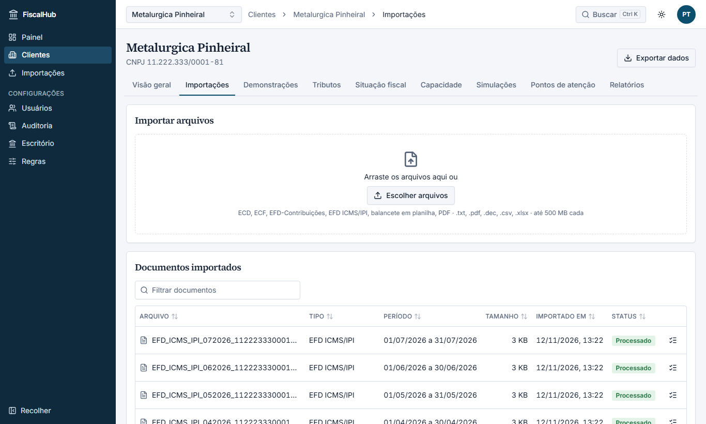 | 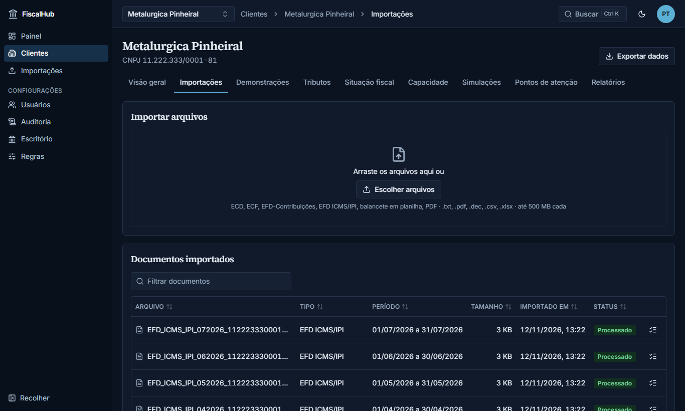 |

## 4. Visão geral, demonstrações e tributos

A **Visão geral** resume certidão, débitos por órgão, divergências, capacidade e os pontos mais graves.
**Demonstrações**: balanço, DRE e DFC por exercício, com análise horizontal e vertical. **Tributos**: a matriz
apurado × declarado × pago por competência; a célula abre as três origens, a diferença e os acréscimos.

| Visão geral | Tributos |
|---|---|
| 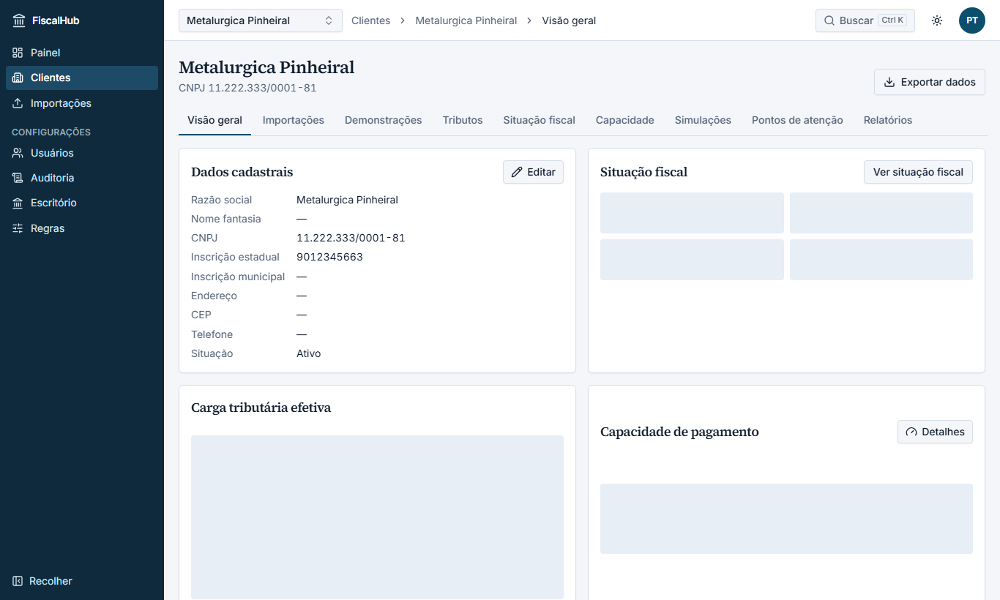 | 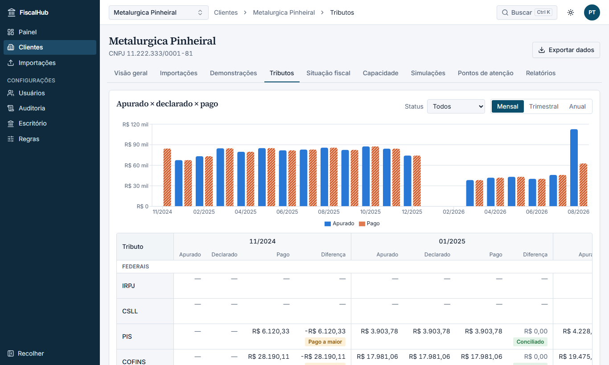 |
| 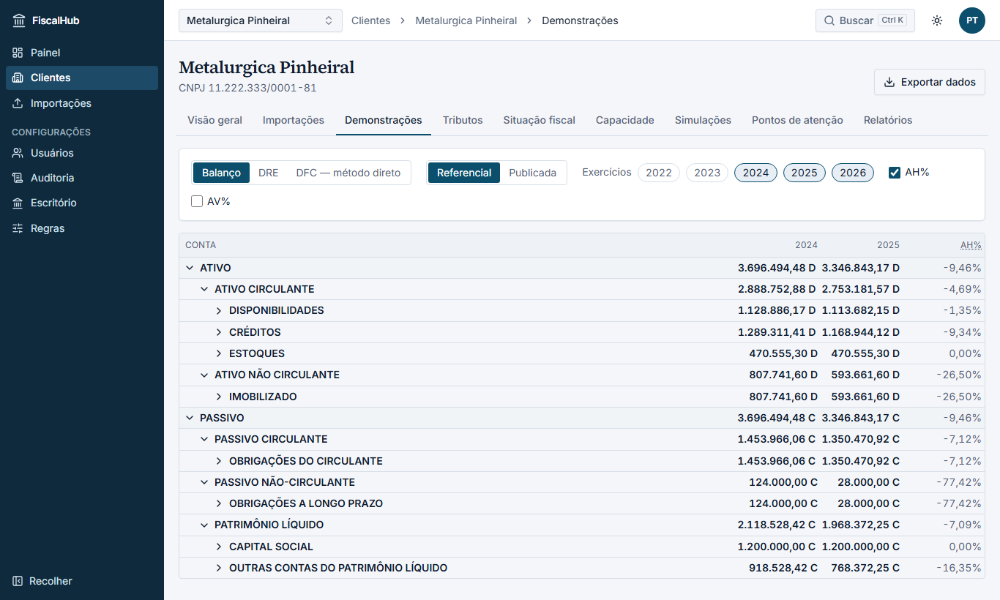 | 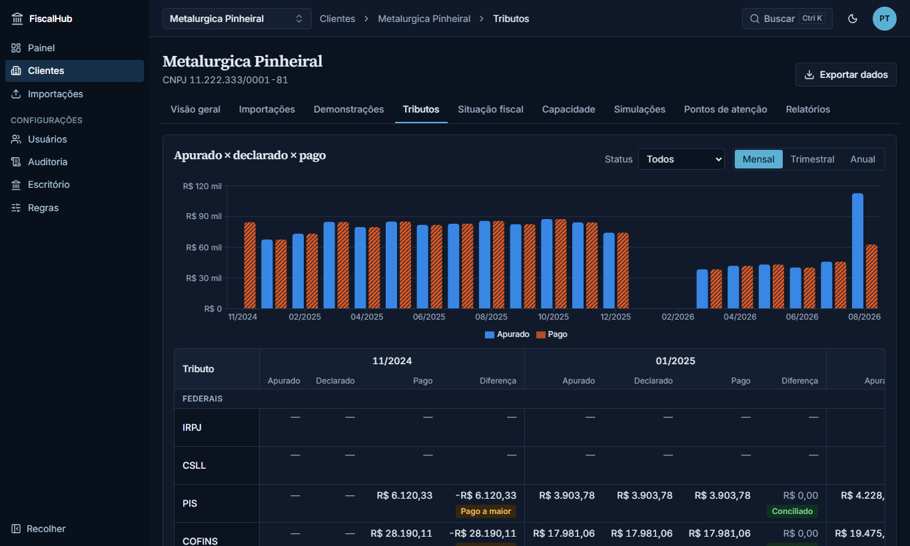 |

## 5. Situação fiscal e capacidade de pagamento

**Situação fiscal**: o que impede a certidão, os débitos por órgão e situação, parcelamentos, pendências e a CAPAG
oficial. **Capacidade**: CAPAG oficial × estimada (PGFN), a classificação do PR com o simulador de CDAs e a análise
gerencial (parcela sustentável), cada uma com o seu rótulo (oficial, estimativa, gerencial).

| Situação fiscal | Capacidade |
|---|---|
| 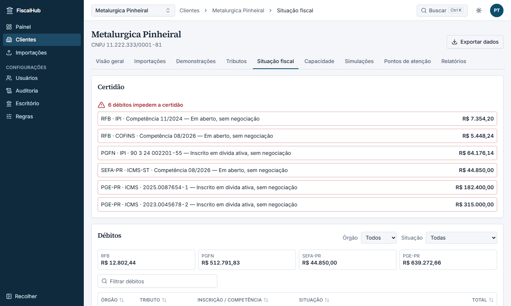 | 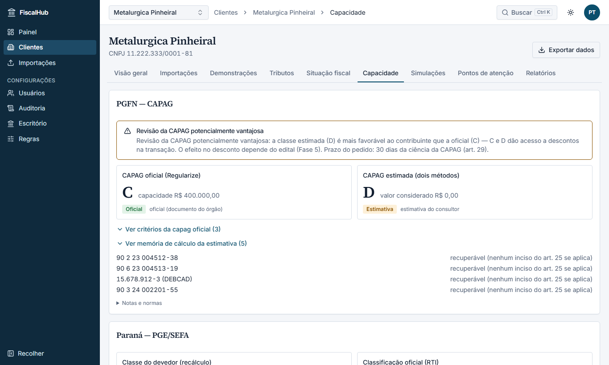 |

## 6. Pontos de atenção

Riscos e oportunidades priorizados, cada um com o fundamento (conferido no texto vigente), a recomendação e as
evidências que levam à tela de origem. Mude o estado (em análise, resolvido, descartado com justificativa).

| Claro | Escuro |
|---|---|
| 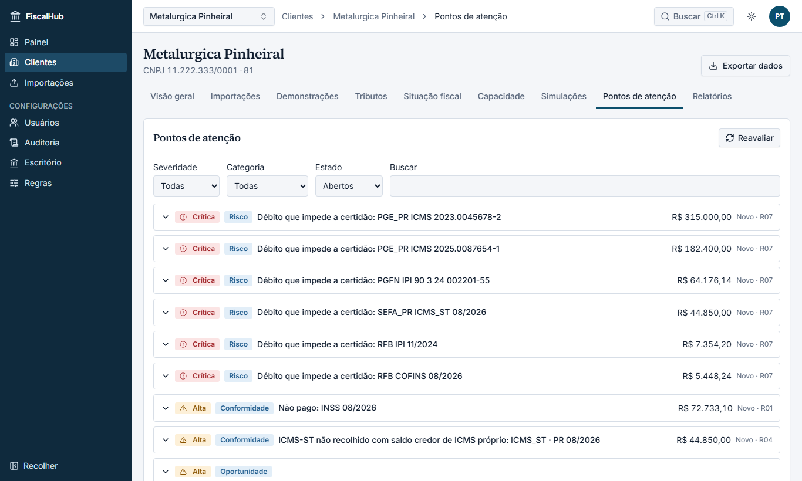 | 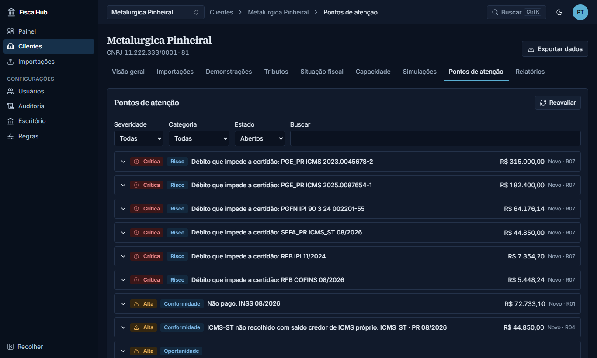 |

## 7. Simulações e proposta de regularização

Escolha os débitos e a data-base: as modalidades de cada órgão (parcelamento, transação, programas) aparecem lado a
lado com custo, desconto, entrada e parcela, a recomendada em destaque e o selo da parcela sustentável. Salve a
simulação e emita, em **Relatórios**, a **Proposta de regularização** (PDF e Excel numerados, com o SHA-256).

| Simulações | Relatórios |
|---|---|
| 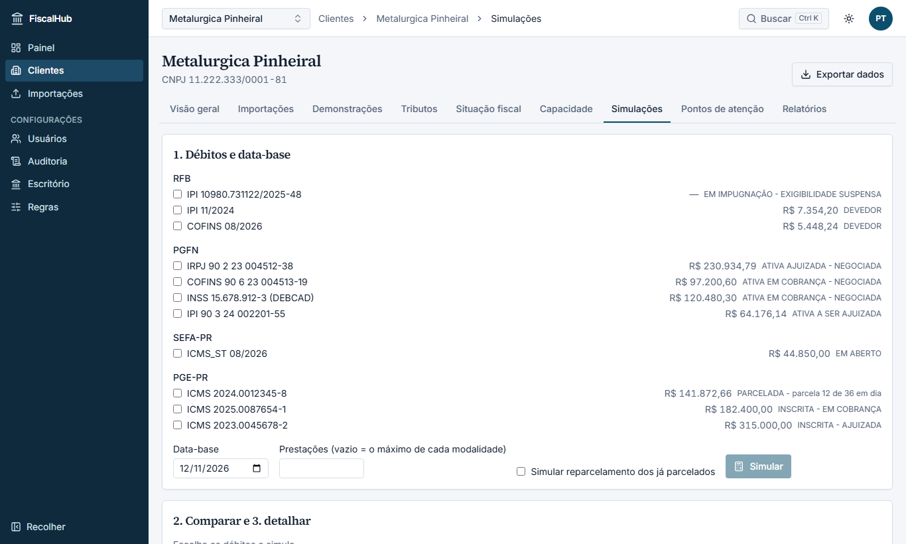 | 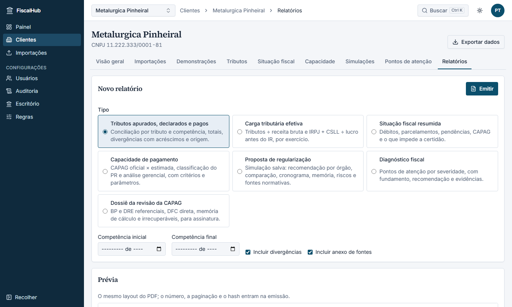 |

## 8. Privacidade

Em **Clientes**, o ADMIN exporta todos os dados de um cliente (ZIP) e agenda a exclusão (com o CNPJ como confirmação e
7 dias para cancelar). Detalhes em [docs/lgpd](../lgpd/README.md).
